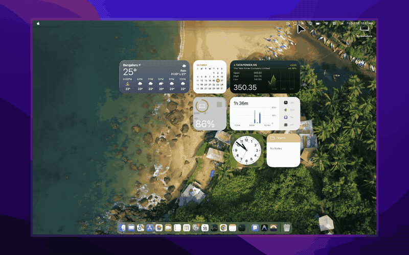

<div align="center">

# ezku.link
### Ultra-Fast macOS Screen Mirroring & 4K Smart TV Streaming

[-000000?style=for-the-badge&logo=apple&logoColor=white)](https://ezku.link)
[](https://ezku.link)
[](https://swift.org)
[](https://developer.apple.com/metal/)
[](https://ezku.link)

**ezku.link** is a native macOS menu bar utility engineered exclusively for Apple Silicon and macOS. Designed to live silently in your top menu bar (`NSStatusItem`) with zero dock clutter (`LSUIElement`), **ezku.link** lets you broadcast your screen, app windows, or local 4K video files to any Smart TV or web browser in **1 click** with sub-30ms ultra-low latency.

<br/>



<br/>

[Website](https://ezku.link) • [Features](#features) • [Installation](#installation) • [Usage Guide](#usage-guide) • [Architecture](#architecture) • [App Store Metadata](#app-store-metadata) • [Support](#support)

---

</div>

<a id="features"></a>
<a id="key-features"></a>
## ✨ Key Features

### 📺 1. Smart TV Direct Casting (Google Cast & DLNA)
- **Automatic Device Discovery**: Instant mDNS/SSDP background scanner discovers Smart TVs on your local Wi-Fi.
- **Universal TV Compatibility**: Works out of the box with:
  - **Chromecast & Google TV** (Sony Bravia, Chromecast with Google TV, Android TV, Google Cast devices)
  - **DLNA / UPnP Media Renderers** (Samsung Tizen, LG webOS, Roku TV, Panasonic, Philips, etc.)
- **No Third-Party TV Apps**: Connects directly over your local network using native TV protocols—no TV app installation required.

### 🖥️ 2. Virtual Extended Screen (TV as 2nd Monitor)
- **True Extended Desktop**: Turn any Smart TV or browser into a wireless second monitor for your Mac.
- **Full macOS Desktop Integration**: Drag app windows, browser tabs, or code editors off the edge of your Mac screen directly onto the TV. Supports Mission Control, Spaces, and arrangement in macOS System Settings.
- **Custom Resolutions**: Choose between **1080p FHD**, **1440p QHD**, or **4K UHD** at smooth 60 FPS.
- **Zero Drivers & Zero Reboot**: Operates in user space using Apple's virtual display pipeline—no kernel extensions, no kexts, no permissions hurdles, and automatic window restoration when disconnected.

### 🌐 3. Zero-Client Web Streaming (`ezku.link`)
- **Watch Anywhere**: Anyone on your Wi-Fi (iPhone, iPad, Android phone, Windows PC, Linux, or TV web browsers) can watch your screen simply by scanning the built-in **QR Code** or navigating to your Mac's local URL.
- **Zero Installs for Viewers**: Pure HTML5 Canvas & Web Audio API receiver client—no plugins, extensions, or downloads needed.
- **TV Browser Mode (`/tv`)**: Tailored 10-foot UI with remote control friendly audio activation and automatic fullscreen.

### 🎬 4. Direct 4K Video Cast
- **Dedicated Media Player**: Switch from screen mirroring to streaming local video files (`.mp4`, `.mov`, `.m4v`, `.mkv`).
- **HTTP Byte-Range Streaming**: Enables smooth scrubbing, seeking, and instant playback on Smart TVs and web browsers without taxing your Mac CPU.

### ⚡ 5. Apple Silicon Hardware Acceleration
- **Capture**: Apple `ScreenCaptureKit` for zero-copy GPU frame acquisition (`IOSurface` / `CVPixelBuffer`).
- **Encoding**: Metal-accelerated GPU compression pipeline (`CIContext` on Metal) with sub-3ms frame encode duration.
- **Ultra-Low Latency**: End-to-end latency of ~15–30ms on local Wi-Fi at 60 FPS.
- **System Audio Loopback**: High-fidelity system audio capture synchronized with video playback.

### 🎛 6. Sleek macOS Menu Bar Interface
- **Zero Dock Clutter**: Lives quietly in the macOS menu bar.
- **Dynamic Status Indicator**: Live pulsing indicator showing active broadcast state.
- **Real-Time Telemetry HUD**: Monitor FPS, output bitrate (Mbps), encode latency (ms), and active viewer count.
- **Quality Presets**:
  - *Ultra 60 FPS*: Optimized scaling for gaming and real-time interaction.
  - *Retina Native*: 100% native resolution for crisp text and coding.
  - *Battery Saver*: 30 FPS adaptive compression for mobile laptop use.

---

<a id="installation"></a>
<a id="quick-start"></a>
## 🚀 Installation & Quick Start

### Option 1: Download Pre-Built DMG (Recommended)

1. Download the latest release from [GitHub Releases](https://github.com/rinturaj/ezku.link/releases/latest):
   - **`ezku.link.dmg`**: Official macOS drag-and-drop installer.
   - **`ezku.link-macOS.zip`**: Standalone application archive.
2. Open `ezku.link.dmg` and drag **ezku.link** into **Applications**.
3. Launch **ezku.link** from Spotlight or Applications.

### Option 2: Build & Run from Source

**Prerequisites**: macOS 14.0+ on Apple Silicon (M1/M2/M3/M4), Xcode Command Line Tools (`xcode-select --install`).

```bash
# 1. Clone repository
git clone https://github.com/rinturaj/ezku.link.git
cd ezku.link

# 2. Build the native macOS bundle
./Scripts/build_app.sh

# 3. Package as macOS .dmg Installer (Optional)
./Scripts/build_dmg.sh

# 4. Launch ezku.link in your menu bar
open "build/ezku.link.app"
```

---

<a id="usage"></a>
<a id="usage-guide"></a>
## 📖 Usage Guide

1. **Click the Menu Bar Icon**: Click the screen cast icon in the top-right macOS menu bar to reveal the popover.
2. **Grant Screen Recording Permission**: On first launch, grant Screen Recording permission in **System Settings > Privacy & Security > Screen & System Audio Recording**.
3. **Select Mode**:
   - **Screen Mirror**: Cast your entire Mac display or a specific app window.
   - **Video Cast**: Drag & drop or browse for a local video file to stream in high resolution.
4. **Choose Destination**:
   - Click **"Mirror to TV"** to broadcast to your discovered Smart TV.
   - Click **"Copy Link"** or display the **QR Code** to share with phones, tablets, or computers on your Wi-Fi.

---

<a id="app-store-metadata"></a>
<a id="app-store-metadata--tags"></a>
<a id="app-store-tags"></a>
## 🏷 App Store Metadata & Tags

Use the following curated metadata for publishing on the **Mac App Store** or product directories:

| Field | Content |
| :--- | :--- |
| **App Name** | **ezku.link** |
| **Subtitle** | `Cast Screen to Smart TV & Web` *(29 chars)* |
| **Bundle Identifier** | `link.ezku.mac` |
| **Primary Category** | Utilities |
| **Secondary Category** | Video / Productivity |
| **Copyright** | © 2026 ezku.link (`https://ezku.link`) |
| **Support URL** | `https://ezku.link` |
| **Marketing URL** | `https://ezku.link` |

### Search Keywords & Tags (App Store 100-Char Limit)
```text
screen mirror,smart tv,cast,chromecast,dlna,airplay,samsung tv,lg tv,stream,display,mac mirror,web cast
```

### Extended SEO Tags & Keywords
`ezku.link`, `ezku link`, `mac screen mirror`, `cast mac to smart tv`, `chromecast mac`, `dlna streamer`, `samsung tv cast`, `lg webos mirror`, `sony bravia cast`, `roku screen mirror`, `mac menu bar utility`, `screen capture kit`, `low latency screen share`, `stream mac to browser`, `wireless display mac`, `apple silicon streaming`.

---

<a id="architecture"></a>
<a id="technical-architecture"></a>
## 🏗 Technical Architecture

### High-Performance Hardware Streaming Pipeline

ezku.link operates fully in user space with zero kernel extensions or third-party dependencies, leveraging native Apple Silicon GPU and networking APIs:

```text
┌────────────────────────────────────────────────────────────────────────┐
│                        macOS WindowServer                              │
└───────────────────────────────────┬────────────────────────────────────┘
                                    │ ScreenCaptureKit (Zero-Copy Frame Acquisition)
                                    ▼
┌────────────────────────────────────────────────────────────────────────┐
│              HardwareVideoEncoder (Metal GPU Pipeline)                 │
│  - CIContext GPU frame processing on Apple Silicon                     │
│  - Dynamic quality presets (Ultra 60 FPS, Retina Native, Battery Saver)│
│  - Real-time telemetry HUD (FPS, Bitrate, Sub-3ms Encode Latency)      │
└───────────────────┬────────────────────────────────┬───────────────────┘
                    │                                │
         AVTransport SOAP (DLNA)             Protobuf Socket (Cast V2)
                    ▼                                ▼
       ┌────────────────────────┐      ┌─────────────────────────┐
       │ Smart TVs (Samsung, LG)│      │ Chromecast & Google TV  │
       └────────────────────────┘      └─────────────────────────┘
                    ▲
                    │ HTTP Byte-Range / WebSocket (Network.framework)
       ┌────────────┴───────────┐
       │ Web Receivers (Canvas) │ (iPhone, iPad, PC, Android, Mac)
       └────────────────────────┘
```

### Directory Structure

```
EzkuLink/
├── Package.swift                  # Swift Package Manager (macOS 14+, Swift 6.0+)
├── Resources/
│   ├── Info.plist                # CFBundleName = ezku.link, permissions
│   ├── EzkuLink.entitlements     # Network server & client entitlements
│   └── AppIcon.icns              # Multi-resolution macOS icon assets
├── Scripts/
│   ├── build_app.sh              # Compiles and packages into native ezku.link.app
│   ├── build_dmg.sh              # Packages signed macOS installer .dmg
│   └── generate_dmg_background.swift # Custom DMG drag-and-drop artwork generator
├── Sources/EzkuLink/
│   ├── main.swift                # App entry point
│   ├── App/
│   │   └── AppDelegate.swift     # Accessory policy & lifecycle
│   ├── Capture/
│   │   ├── ScreenCaptureEngine.swift # Apple ScreenCaptureKit screen & audio engine
│   │   └── VirtualDisplayManager.swift # User-space Virtual 2nd Display Engine
│   ├── Encoder/
│   │   └── HardwareVideoEncoder.swift # Metal GPU acceleration & telemetry
│   ├── Server/
│   │   ├── StreamingServer.swift  # Apple Network.framework HTTP & WebSocket server
│   │   └── WebClientAssets.swift  # Zero-latency HTML5 / Canvas / WebAudio web client
│   ├── TV/
│   │   ├── SmartTVDiscovery.swift # mDNS / SSDP TV scanner
│   │   ├── GoogleCastController.swift # Google Cast / Chromecast V2 protocol
│   │   └── DLNAController.swift   # UPnP / DLNA AVTransport SOAP controller
│   ├── UI/
│   │   ├── MenuBarController.swift # NSStatusItem controller
│   │   ├── MenuBarPopoverView.swift # SwiftUI popover UI with TV list & QR code
│   │   ├── VisualStyles.swift     # Liquid glass cards & button styles
│   │   └── WelcomeOnboardingWindow.swift # User onboarding & quick start guide
│   └── Utils/
│       ├── NetworkUtils.swift     # Local IP detection & QR generator
│       └── PermissionManager.swift# Screen recording permission helper
└── Tests/EzkuLinkTests/           # Comprehensive Swift Testing suite
```

---

<a id="support"></a>
<a id="support--community"></a>
## ☕ Support & Community

If you find ezku.link useful, consider supporting future development:
- **Website**: [https://ezku.link](https://ezku.link)
- **Buy Me a Coffee**: [buymeacoffee.com/rin2](https://www.buymeacoffee.com/rin2)

---

## 📄 License
All rights reserved © 2026 **ezku.link** (`https://ezku.link`).
